# Como usar o InstaSearch

O caminho de um vídeo, tela por tela, as outras telas do app e um glossário dos termos. Para instalar, veja [INSTALACAO.md](INSTALACAO.md); para entender o código, [ARQUITETURA.md](ARQUITETURA.md).

## Quem faz o quê

🟨 **você decide** · 🟦 **a IA sugere** · 🟩 **o app executa**

| Etapa | Quem faz |
|---|---|
| Tema, estilo, tom e duração | **Você** (ou um clique numa ideia guardada) |
| Roteiro com argumento e provas, dividido em cenas | **IA** (pesquisa na web antes de escrever) |
| Voz | **Você**: celular, microfone, ElevenLabs |
| Legenda e cortes no tempo da sua fala | **App** (Whisper, no seu computador) |
| Imagem, figurinha, efeito sonoro e música de cada cena | **App + IA** |
| Conferir e pedir mudanças ("na cena 6 põe um X") | **Você**, na prévia ao vivo |
| Render do MP4 e publicação | **App** |

## A jornada de um vídeo, tela por tela

### 1. Novo vídeo

- **Tema** ("Por que o Luffy nunca mata ninguém?"), **estilo** (Comentário de anime, Explicativo, Curiosidades, História, Ranking, Edit, POV ou um seu), **duração** (15 a 40 s) e **tom**.
- **Tons** são o jeito de falar do roteiro: vêm *Polêmico*, *Curioso*, *Mistério* e *Papo reto*, e você cria os seus (à mão ou descrevendo para a IA) em **Biblioteca → Tons** ([ADR 0019](decisions/0019-roteiro-com-argumento-e-tons-proprios.md)). Todos se editam ali mesmo, sem cópia, inclusive os 4 que vêm com o app, que só não podem ser apagados ([ADR 0031](decisions/0031-tons-editados-no-lugar.md)).
- Já tem o texto? Marque **"Já tenho o texto da narração"**: a IA só divide em cenas, sem mudar nada.
- **Gerar roteiro**: a IA faz até **4 buscas na web** atrás de provas e escreve na estrutura *gancho → tese → provas concretas → conclusão → chamada para comentar*. A tela mostra o que ela buscou e **qual IA escreveu** (selo azul = Gemini, laranja = Claude).

### 2. Roteiro e voz

- Cada cena tem a **legenda** (amarela), a **fala** e o que a imagem precisa mostrar. Tudo é editável; o ✕ tira a cena.
- **Peça uma mudança** no topo ("gancho mais polêmico", "tira a parte do Kaido").
- **Sua voz:** copie a narração, grave e suba o áudio. Dá para montar sem áudio e subir depois.
- Num vídeo já montado (inclusive um **🤖 criado sozinho**), o botão vira **Revisar o vídeo →**: a voz só ajusta o tempo da legenda e dos cortes. "↻ Montar de novo" continua ali, mas escolhe outra vez as imagens que não foram travadas.

### 3. Montagem

Você não faz nada: o app busca na web uma imagem por cena (a IA olha as sugestões e escolhe; leva 1 ou 2 minutos), põe as figurinhas de reação, os efeitos sonoros nos cortes (whoosh nas setas, erro nos X, boom no gancho) e uma música do clima do estilo. A tela mostra cada decisão e abre a revisão sozinha. Como as imagens são escolhidas está em [ARQUITETURA.md](ARQUITETURA.md#montagem-e-imagens).

### 4. Revisão

O centro do app. A **prévia ao vivo** é a composição final: o que você vê é exatamente o que vai para o MP4.

A tela tem três partes ([ADR 0037](decisions/0037-efeitos-da-cena-na-frente-e-chat-secundario.md)):

- **À esquerda, o vídeo** e, embaixo dele, os **ajustes do vídeo inteiro** em botões com o valor atual (tabela abaixo). Mais embaixo, **Precisa de você** (cenas sem imagem → **Escolher eu mesmo** ou **✨ Preencher automaticamente**) e **Sobre este vídeo** (o que a IA montou, a legenda no tempo da voz, por que este tema, quem fez).
- **No centro, as cenas.** A faixa mostra a miniatura de cada cena (borda vermelha tracejada = sem imagem; laranja = imagem parecida; ponto amarelo = você escolheu efeitos nela) e, entre duas cenas, o ícone da **transição** (│ corte seco, ⚡ flash branco, ◼ flash preto, 〰 tremida, ⊕ zoom rápido). Clique numa cena para abri-la (`/projeto/:id?cena=3` abre direto numa cena); clique no ícone entre duas para ir à linha **Entrada** da cena seguinte.
- **Efeitos da cena**: cada efeito é uma linha com as opções à vista. A primeira é **✨ Auto** (o que a IA fez, com o valor: "Auto · zoom in"); a escolhida fica amarela. **Passe o mouse numa opção e o player toca a cena com ela**, sem salvar; um clique aplica nesta cena. Depois de escolher, **⇉ usar em todas as cenas** leva a escolha para o vídeo inteiro. **↺ Voltar ao que a IA fez** desfaz as escolhas das quatro linhas da cena.

| Linha | Opções |
|---|---|
| Movimento | Parado · Zoom in · Zoom out · Tremer · Deslizar |
| Entrada | Corte seco · Flash branco · Flash preto · Tremida · Zoom rápido: como a cena entra no corte. No Auto, o ritmo decide como antes (flash em todo corte no Frenético, a cada 4 cenas no Rápido) |
| Zoom em | As áreas que a IA marcou na imagem (rosto, mão…) ou a imagem inteira. É onde o zoom termina e para onde a seta e o círculo apontam |
| Destaque | Nada · Círculo · Seta · X (a reação é a figurinha) |

- **Também**, na linha de baixo, os controles com listas grandes, em pop-up como antes: **🖼 Trocar imagem** (abre a tela Trocar imagem), **▣ Fundo** (tabela mais abaixo), **🔊 Som** (automático, sem som ou um da biblioteca, com **▶** para ouvir, e os volumes **Todos os efeitos** e **Esta cena**) e **😮 Figurinha** (Automático, Nenhuma ou uma da biblioteca; a escolhida aparece mesmo numa cena sem reação, e nem a montagem, nem o chat, nem o ajuste "Figurinhas" a trocam).
- **O chat fica numa barra embaixo**: escreva o pedido ali (o que precisa de texto: "final mais polêmico", "troca a música"); a barra mostra a última resposta, **↶ Desfazer** e **Conversa (n) ▴**, que abre a conversa inteira numa gaveta à direita (Esc recolhe). Cite cenas pelo número da tela ("na cena 6 põe um X", "cenas 3 e 4", "esta cena"). Se o pedido cita cenas, **só elas mudam**: se a IA mexer em outra, o app desfaz. A resposta diz o que *de fato* mudou, conferido pelo app ([ADR 0017](decisions/0017-troca-de-imagem-rapida-e-chat-na-cena-certa.md)). Um efeito que **você** escolheu só muda se o pedido citar a cena **e** falar do efeito ("tira o tremor da cena 3"); num pedido geral ("mais movimento"), ele fica, e a resposta diz em quais cenas.
- **Ajustes do vídeo inteiro**:

| Ajuste | Opções |
|---|---|
| Imagens | **↻ Buscar imagens de novo**: troca as imagens que a montagem escolheu; as que você escolheu ficam. As imagens vêm sempre da web, nunca de vídeos anteriores ([ADR 0022](decisions/0022-imagens-da-web-e-controles-da-cena.md)) |
| Ritmo | Calmo · Normal · Rápido · Frenético (a IA junta ou divide cenas, sem mudar a fala) |
| Efeitos | Poucos · Na medida · Muitos (setas, X, círculos, reações) |
| Figurinhas | **Nenhuma** (tira as automáticas na hora, sem IA) · **Poucas** (onde a IA pôs uma reação; é o padrão) · **Muitas** (a IA põe reações em cerca de 1 cena a cada 3). As escolhidas na cena ficam. Só aparece figurinha quando alguma da biblioteca combina com a reação |
| Legenda | Quadrinho (1 a 3 palavras-chave) · **Completa** (toda a fala, a palavra dita acende) · Limpa · Sem |
| Música | uma da biblioteca · Sem música (ela abaixa sozinha quando tem voz) |
| Abertura / Final | Nenhum · um dos seus bordões ([ADR 0016](decisions/0016-bordoes-de-abertura-e-final.md)) |

**▣ Fundo da cena**, um pop-up com uma miniatura de cada jeito, feita com a imagem da própria cena:

| Opção | Como fica |
|---|---|
| Automático | O que a IA escolheu: cena de *prova* vai na moldura; imagem larga aparece inteira sobre ela mesma desfocada; imagem em pé, em tela cheia |
| Tela cheia | Corta para ocupar a tela toda |
| Inteira | A imagem toda, sobre ela mesma desfocada |
| Moldura no quadriculado | Emoldurada e inclinada, no fundo quadriculado das provas |
| Moldura sobre a imagem | A mesma moldura, com a própria imagem desfocada atrás |

Vale na prévia e no MP4. Se o chat trocar a imagem ou o tipo da cena, o fundo volta para o Automático.

### 5. Trocar imagem

Uma cena por vez ("Cena 1 de 3"). A tela já abre com **sugestões da internet** buscadas a partir do que a cena precisa mostrar, junto com a **obra do vídeo** ("Night City visto de cima" vira "… Cyberpunk: Edgerunners"), que o roteiro anota ao escrever ([ADR 0024](decisions/0024-imagens-do-assunto-do-video.md)):

| Fonte | O que traz | Precisa de chave? |
|---|---|---|
| Bing Imagens | Resultados gerais e **painéis de mangá** (primeiro quando a cena pede mangá). Busca segura no rígido; com **Imagens sugestivas** ligada, no moderado (passa o sugestivo, nunca o explícito) | Não |
| Danbooru | Ilustrações classificadas como "geral" (e "sensível", o sugestivo sem nudez, com **Imagens sugestivas** ligada) do personagem da cena, filtradas pelas etiquetas (`smirk`, `hands_in_pockets`…). É a fonte de fanart: na montagem, metade das sugestões que a IA olha vem daqui, e na tela Trocar imagem elas vêm alternadas com as da web. Cena sem personagem não usa | Não |
| AniList | A arte oficial do personagem (desempata "Sakura" pela série do vídeo) | Não |
| Google Imagens | Via [serper.dev](https://serper.dev), 2.500 buscas grátis | `SERPER_API_KEY` |

**Clique numa** e pronto: ela entra na cena e a tela passa para a próxima. Também dá para colar (Ctrl+V), arrastar um arquivo, colar um link ou buscar outro texto. Cerca de 1 cena a cada 3 vem marcada com **meme** ou **variação** (chibi, versão mulher; as variações são as mais comuns), e essas cenas ganham o botão **😂 Buscar o meme** ([ADR 0020](decisions/0020-imagens-especificas-memes-e-zoom.md)).

### 6. Publicar

O modal gera a **legenda do post** com hashtags e já começa o **render do MP4** (1080×1920, 30 fps). O primeiro render demora mais (prepara o Remotion e baixa o Chrome headless); se o vídeo não mudou, o MP4 guardado é reaproveitado.

- **⬇ Baixar MP4**, **Publicar no Instagram** (Reels) ou **Enviar ao YouTube** (Short, com título e privacidade).
- Depois de publicar, o projeto vai para **Projetos → Publicados**, e as métricas dele passam a alimentar a tela [Ideias](#as-outras-telas).

## As outras telas

| Tela | Para quê |
|---|---|
| **Início** (`/`) | Criação rápida (tema + estilo + Começar), seus vídeos e próximas publicações |
| **Projetos** (`/projetos`) | Todos os vídeos, filtrados por etapa: no roteiro, faltam imagens, prontos, salvos, publicados |
| **Ideias** (`/ideias`) | **Desempenho**: cada Reel e Short comparado com a mediana dos seus vídeos na mesma idade ("2,4× a sua mediana, aos 7 dias"). **Ideias**: a IA propõe lotes de 6 temas, cada um com as provas (seus números, comentários do público, o que está em alta na web). Guardar, descartar com motivo, **Criar vídeo** ([ADR 0021](decisions/0021-ideias-a-partir-do-desempenho.md)). **🤖 Criar sozinho** (no cartão, com aquela ideia) e **🗣️ Debater e criar um vídeo** (no alto): duas IAs Sonnet 5.5, a **Estrategista** (números e público do canal) e a **Roteirista** (gancho, argumento e imagens), debatem 4 temas de um brainstorm delas, nas obras que o canal já fala e sem repetir assunto. Os 4 são de **obras diferentes**, e o app tira os que repetem a personagem de um dos 3 últimos vídeos ou uma obra que já tem 2 dos 4 últimos (a lista do que ficou fora aparece no chat). Os temas são **opiniões fortes e polêmicas**, e pelo menos metade tem fanservice, de preferência com uma personagem mulher; nada com cara de notícia. Cada tema vem marcado **🔥 em alta** (o tema fala de algo das últimas semanas, não basta a obra estar em evidência) ou **🕰️ atemporal**, para o canal não viver só de hype, e um deles pode ser uma **🎲 aposta**: algo bombando no mesmo nicho, numa obra que o canal nunca tratou ([ADR 0028](decisions/0028-variedade-nos-temas-do-debate.md)). Outro pode ser uma **🔁 volta**: uma personagem de um vídeo seu que ficou acima da mediana de visualizações, com um assunto novo, livre da regra dos 3 últimos vídeos e da obra. Para não sugar a personagem, ela não volta se foi a do último vídeo, e descansa quando já tem 3 dos últimos 8 vídeos (isso vale para qualquer tema) ou quando o vídeo mais recente dela ficou abaixo da mediana ([ADR 0033](decisions/0033-volta-de-personagens-que-deram-views.md)). O debate aparece como um chat ao vivo, e o vídeo só é criado quando as duas votam no mesmo tema, em no máximo 6 falas por rodada ([ADR 0027](decisions/0027-debate-das-ias-antes-de-criar.md)). Se as duas recusam os 4 temas, ou as falas acabam sem acordo, vêm 4 temas novos, até **3 rodadas**; depois disso, nenhum vídeo. Quando as duas concordam, você tem **5 segundos** para clicar em **✋ Não gostei, vetar**: o tema sai, e elas seguem debatendo os outros. **■ Parar debate** encerra tudo sem vídeo ([ADR 0030](decisions/0030-debate-em-rodadas-com-veto.md)). Cada tema tem um **formato**: opinião com provas, X contra Y, E se…, mito ou verdade, ou antes e depois, e o app não repete o formato dos 2 últimos vídeos. A **🏆 tier list** está pronta, mas **desligada por enquanto** (adendo ao ADR 0036). Ela é uma **série**, um personagem por vídeo: o quadro (S, A, B, C, D) abre com quem já foi ranqueado nos vídeos anteriores, a narração defende o personagem da vez sem dizer a letra e, na palavra que aponta ("o lugar dele é **aqui**"), ele voa para a fileira. Na Revisão, **Fileira** troca a posição (o quadro dos vídeos seguintes acompanha); antes de gravar, **↻ Ajustar o roteiro** reescreve o argumento, e o chat também troca ("põe o Garou no B") ([ADR 0036](decisions/0036-formatos-de-video-e-tier-list.md)). Com acordo, a **Roteirista** escreve o roteiro, já com o gancho e o porquê combinados, e a **Estrategista** revisa: coesão, se faz sentido, a estrutura, a duração, se é o tema combinado e os fatos, conferidos na web. Sem aprovação, vem uma versão nova, até 3 reescritas; se nenhuma passar, o vídeo segue com a última, e o que sobrou aparece em **📝 Revisão do roteiro** no projeto. A revisão aparece no chat, depois do acordo, e vale também no **🤖 Criar sozinho** ([ADR 0034](decisions/0034-revisao-do-roteiro-pelas-ias.md)). Depois, o app monta e procura as imagens, um vídeo por vez, mostrando a etapa de cada um. Para em "falta gravar a voz" e nunca publica; se parar no meio, **Continuar** segue da etapa ([ADR 0026](decisions/0026-criacao-autonoma-de-videos.md)). O projeto mostra **🗣️ Por que este tema**, com o link para o debate |
| **Biblioteca** (`/biblioteca`) | O material que você cuida: figurinhas (PNG transparente), efeitos sonoros (nomeie `whoosh_01.mp3`), músicas (cole o link de um Reel/TikTok/Short), bordões, tons e vídeos (as cenas de um episódio, para usar na tela Trocar imagem). Não há aba de imagens: as das cenas vêm da web a cada vídeo ([ADR 0022](decisions/0022-imagens-da-web-e-controles-da-cena.md)) |
| **Estilos** (`/estilos`) | Cada estilo é uma configuração (ritmo, efeitos, legenda, música, tipo de imagem, instruções para a IA). Mudar um que vem com o app salva uma cópia sua |
| **Calendário** (`/calendario`) | Posts agendados, publicados e com falha; publicar agora, cancelar |
| **Configurações** (`/configuracoes`) | Contas conectadas (Instagram, YouTube), estado de cada IA (com a hora em que a cota do Gemini volta), o download do Whisper e **Imagens sugestivas**: desligada por padrão; ligada, as sugestões da web trazem fanservice e pose ousada (Bing moderado, Danbooru "sensível"), e a IA que escolhe as imagens prefere a versão mais ousada de uma personagem, mas nunca nudez. O Bing não deixa desligar o filtro de vez num pedido pela internet |
| Ferramentas antigas | As telas da primeira versão do projeto (publicar clipes prontos, gerador de prompts, perfis). Ficam no rodapé do menu; a maioria é *stub* |

**Bordões** são o que abre ou fecha o vídeo, em três tipos: **clipe pronto** (um vídeo seu com som), **montado** (imagem + um áudio seu + texto) e **se inscreve** (foto, @, frase e o botão sendo clicado). No **se inscreve**, um modelo pronto (YouTube, Instagram, TikTok ou Canal) preenche o botão e as cores, e o texto depois do clique é seu ("SIGA-ME" → "SEGUINDO"; vazio, o app adivinha). Dá para esconder a foto, o nome, a frase ou o botão, escolher a entrada (pulo, deslizar, zoom, tremida) e o clique (cursor, dedo, pulsar, sem clique) e pôr um áudio seu. No **montado**, o texto pode pular, ser digitado ou tremer, em cima, no meio ou embaixo. Sem áudio, o bordão dura de 2 a 6 s, e em todos dá para deixar a música do vídeo tocando por baixo ([ADR 0032](decisions/0032-bordoes-personalizaveis.md)).

## Glossário

| Termo | O que é |
|---|---|
| **Cena** (*beat*, batida) | Um pedaço do vídeo: um trecho da fala com uma imagem. Um Short costuma ter de 10 a 40 |
| **Prova** (*evidence*) | Cena que mostra um print ou painel como evidência, emoldurada e inclinada |
| **Estilo** | Receita de edição: ritmo, efeitos, legenda, música, tipo de imagem |
| **Tom** | Jeito de falar do roteiro (Polêmico, Mistério…) |
| **Bordão** | O que abre ou fecha todo vídeo, como uma vinheta |
| **Figurinha** | Imagem de reação (PNG transparente) que aparece sobre a cena |
| **Automático** | O valor que a IA escolheu. Todo controle da cena começa nele |
| **Travado** (*locked*) | Escolha sua que a montagem e o chat não trocam mais |
| **Montagem** | O passo em que o app põe imagem, figurinha, som e música em cada cena |
| **Reserva** (*fallback*) | A IA que entra quando a anterior falha |
| **Remotion** | Biblioteca que descreve vídeo como componentes React |
| **Whisper** | Programa que transcreve áudio e dá o tempo de cada palavra |
| **ADR** | *Architecture Decision Record*: o registro do porquê de uma decisão |
